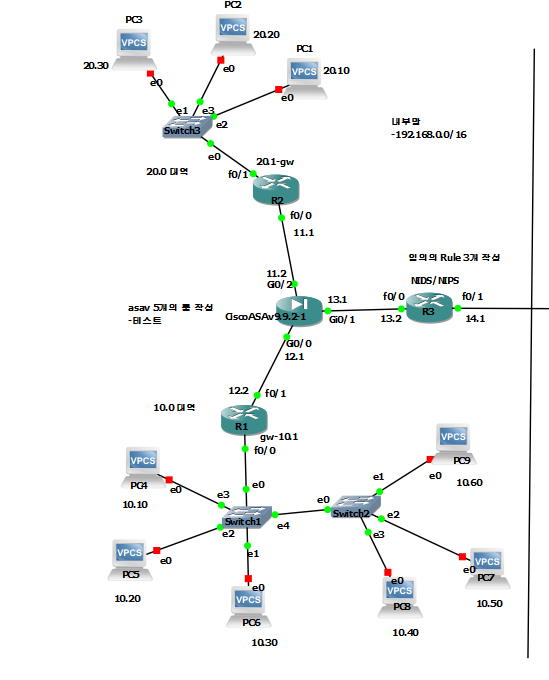

## 직접 구축하고, 확인한 것만 보여드립니다.

인프라·네트워크·보안을 직접 구축하며 배우고 있습니다.
설정을 바꾸면 통신과 로그로 결과를 확인하고, 확인한 것만 "됐다"고 말합니다.

- 희망 직무: **네트워크 엔지니어 · 시스템/인프라 엔지니어 · 보안관제(정보보안)**
- 교육: SKT ALEPH K-뉴딜 아카데미 (2026.08 ~ 2026.11, 500시간)
- 포트폴리오: **https://sby1234-ai.github.io/myprofile/**
- 연락처: akrrkt56@gmail.com

---

### 대표 프로젝트

| 프로젝트 | 내용 | 링크 |
|---|---|---|
| **Full-Security Labs** (개인) | GNS3에 VLAN 10/20/30·OSPF·ASAv 방화벽 규칙 5개·라우터 ACL 탐지 규칙 3개를 하나의 토폴로지로 구성하고, 서버·SIEM(Wazuh)·pfSense OpenVPN·Suricata는 VirtualBox에 따로 구축해 ping·hitcnt·로그로 동작 검증 | [결과보고서(PDF)](https://sby1234-ai.github.io/myprofile/docs/security-labs-report.pdf) |
| **BYTE BACK 방어전** (교육 과제) | 클라우드에 배포한 교육용 웹 서비스를 12단계에 걸쳐 방어 — 공개 데이터 차단 → 로그인 검증·소유자 검사 → DB 권한 회수 → 탐지·권한 회수 제안 → 백업 복원 → 기기 승인 → 실측 작전실. 평가 공격 41종 대응, 1~12단계 통과 | [저장소](https://github.com/sby1234-ai/choi-bujang-secret-vault) · [상세](https://sby1234-ai.github.io/myprofile/byteback.html) |
| **케셰브** (교육 과제) | 로그인·접근 판정·XDR 경보 조회·AI 사건 설명·조치 결과 확인 화면을 갖춘 보안 Agent, 13~22단계 통과. 저장된 경보를 보여 주는 화면까지이며 실시간 탐지 엔진은 만들지 않음 | [저장소](https://github.com/sby1234-ai/kesheb-defense) · [상세](https://sby1234-ai.github.io/myprofile/kesheb.html) |
| **런메이트** (개인 앱) | 걷기·뛰기를 자동으로 나눠 기록하는 안드로이드 러닝 앱, GitHub Actions로 빌드·릴리스 | [저장소](https://github.com/sby1234-ai/runmate) |

<b>Full-Security Labs — 직접 구성한 GNS3 토폴로지(내부망 구간) 보기</b>

 

R1·R2 아래 내부 구역과 ASAv 방화벽, 외부망으로 이어지는 R3(라우터 ACL 탐지 규칙)까지의 구성입니다. 외부망 VLAN 10/20/30 구간과 VirtualBox 서버 구성은 결과보고서에 정리했습니다.

그 밖의 실습(Rocky 서버 구축, Snort·Suricata 룰, OSSEC·Wazuh·Zabbix·PMM, KISA 가이드 점검 스크립트, CTF 머신 10개 공략과 자작 머신 VaultCorp)은 [포트폴리오](https://sby1234-ai.github.io/myprofile/)에 정리했습니다.

---

### 다뤄 본 기술

- **네트워크**: Cisco 라우터·스위치(VLAN, OSPF, HSRP, ACL, NAT), GNS3, Packet Tracer
- **방화벽·VPN**: Cisco ASAv, pfSense, OpenVPN
- **탐지·관제**: Snort, Suricata, OSSEC, Wazuh, XDR 에이전트 연동
- **모니터링·로그**: Zabbix, PMM, Adiscon LogAnalyzer, rsyslog
- **서버**: Rocky Linux, Ubuntu — DNS(BIND), Apache, MariaDB, Samba, NFS, FTP, Docker
- **점검·자동화**: Bash(KISA 가이드 점검·조치 스크립트), Git, GitHub Actions

### 준비 중인 자격증

- 네트워크관리사 2급 — 필기 합격, 실기 준비 중
- 리눅스마스터 2급 — 1차 합격, 2차 준비 중
